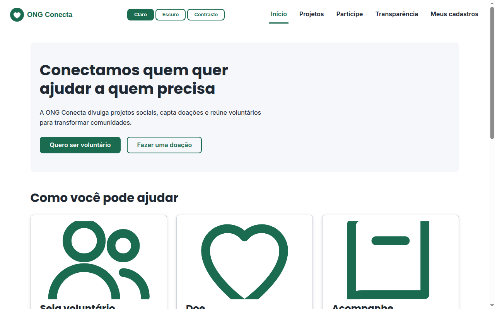
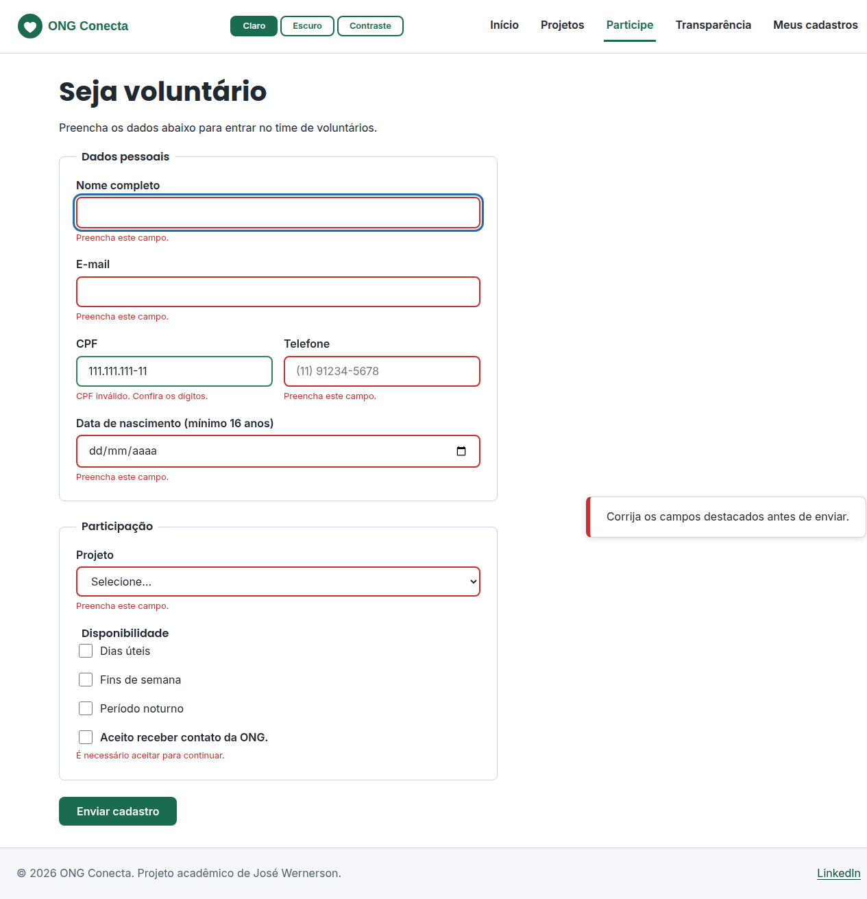
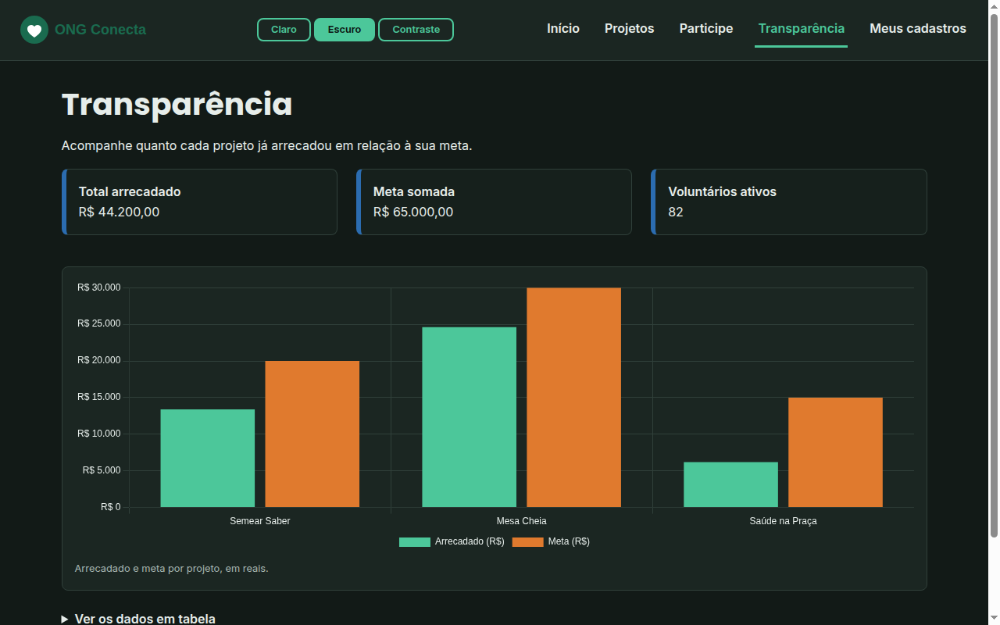
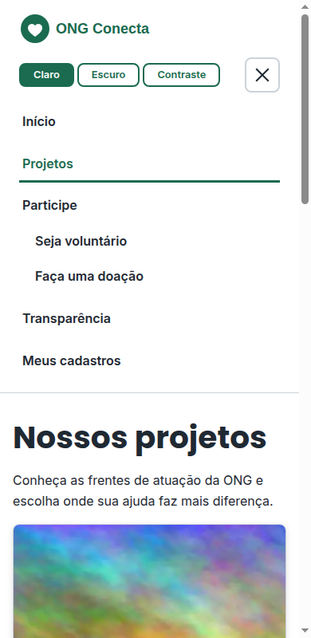

# ONG Conecta

SPA em **HTML, CSS e JavaScript puro** para uma plataforma de ONG: divulgar projetos sociais, captar doações e cadastrar voluntários. Trabalho acadêmico desenvolvido com foco em semântica, acessibilidade e organização de código.

**Demonstração:** https://jose-wernerson.github.io/ong-conecta/

## Funcionalidades

- Navegação por hash (`#/`, `#/projetos`, `#/cadastro`, `#/doacao`, `#/transparencia`, `#/meus-cadastros` e página 404) sem recarregar a página.
- Cadastro de voluntários e registro de doações com validação em tempo real (blur, input e submit): campos obrigatórios, e-mail, CPF com dígitos verificadores, telefone com máscara, idade mínima de 16 anos e valor mínimo de R$ 5,00.
- Rascunho automático do cadastro e tela **Meus cadastros** com os registros salvos no navegador (`localStorage`).
- Cards de projetos com barra de progresso, modal de detalhes, toasts e confirmação de remoção.
- Tela de **Transparência** com gráfico de barras (Chart.js) e tabela de dados como alternativa.
- Três temas: claro, escuro e alto contraste, respeitando `prefers-color-scheme`, `prefers-contrast` e `forced-colors`.
- Páginas de fallback sem JavaScript em `html/` (projetos, cadastro e doação).

## Tecnologias

| Área | Uso |
|---|---|
| Linguagens | HTML5, CSS3 (variáveis, Grid, Flexbox) e JavaScript ES Modules |
| Build | [Vite](https://vite.dev/) (minificação com esbuild) |
| Qualidade | [ESLint](https://eslint.org/) e W3C Nu Html Checker |
| Bibliotecas (CDN, carregadas sob demanda) | [Chart.js](https://www.chartjs.org/) e [Day.js](https://day.js.org/) com locale `pt-br` |
| Fontes | Poppins (títulos) e Inter (texto) |
| Deploy | GitHub Actions + GitHub Pages |

## Capturas de tela

| Início | Validação do cadastro |
|---|---|
|  |  |

| Transparência (tema escuro) | Menu mobile |
|---|---|
|  |  |

## Pré-requisitos

- [Node.js](https://nodejs.org/) 20 ou superior (testado com 22)
- npm 10 ou superior

## Instalação e execução

```bash
git clone https://github.com/jose-wernerson/ong-conecta.git
cd ong-conecta
npm install
npm run dev
```

O servidor de desenvolvimento abre em `http://localhost:5173/ong-conecta/` (o `base` do Vite é `/ong-conecta/`).

| Script | O que faz |
|---|---|
| `npm run dev` | Servidor de desenvolvimento com HMR |
| `npm run build` | Gera a versão de produção em `dist/` |
| `npm run preview` | Serve o `dist/` localmente |
| `npm run lint` | Executa o ESLint |

## Build e deploy

O deploy é automático: a cada push na `main`, o workflow `.github/workflows/deploy.yml` executa `npm ci`, `npm run lint`, `npm run build` e publica o `dist/` no GitHub Pages. Para ativar, em **Settings > Pages** escolha **GitHub Actions** como fonte.

O workflow `.github/workflows/ci.yml` roda lint e build em pull requests para a `develop`.

## Testes e qualidade

- `npm run lint` (ESLint com regras `eqeqeq`, `no-var`, `prefer-const` e `no-unused-vars`).
- Validação de HTML e CSS com o W3C Nu Html Checker:
  ```bash
  npx vnu-jar --also-check-css html/*.html css/*.css
  ```
- Verificação manual: navegação só com teclado, leitor de tela e os três temas.

## Estrutura de pastas

```
ong-conecta/
├── index.html            # app shell da SPA
├── html/                 # páginas de fallback sem JavaScript
│   ├── projetos.html
│   ├── cadastro.html
│   └── doacao.html
├── css/
│   ├── variables.css     # tokens: cores, tipografia, espaçamentos e temas
│   ├── base.css          # reset, tipografia e acessibilidade base
│   ├── layout.css        # grid de 12 colunas e flexbox estrutural
│   ├── components.css    # botões, cards, formulários, modal, toasts...
│   └── style.css         # importa os demais, nessa ordem
├── js/
│   ├── main.js           # ponto de entrada: rotas e ações
│   ├── router.js         # roteamento por hash
│   ├── templates.js      # telas com Template Literals e escape()
│   ├── data.js           # dados dos projetos
│   ├── validation.js     # regras, máscaras e erros
│   ├── storage.js        # único acesso ao localStorage (prefixo "ong:")
│   ├── ui.js             # menu, tema, toasts, modal e delegação de eventos
│   └── charts.js         # Chart.js e Day.js sob demanda
├── public/imagens/       # logo/, projetos/ (WebP 480/800/1200px) e icones/
├── docs/screenshots/
└── .github/              # workflows e template de pull request
```

## Acessibilidade

- Link "Pular para o conteúdo", `<main id="app" tabindex="-1">` e foco movido para o `<h1>` a cada troca de rota.
- Menu hambúrguer com `aria-expanded` e `aria-controls`; submenu abre por `:hover` e `:focus-within`.
- Formulários com `label`, `fieldset`, `aria-invalid` e `aria-describedby`; foco no primeiro campo inválido.
- Barras de progresso com `role="progressbar"`, toasts em região `aria-live="polite"`, alertas com `role="alert"`/`status`.
- Modal com `role="dialog"`, `aria-modal`, focus trap e fechamento com Esc.
- Seletor de tema com `aria-pressed`; suporte a `prefers-reduced-motion`.
- Gráfico com descrição textual e tabela equivalente.

## Privacidade

Os cadastros e doações são apenas simulados e ficam salvos **somente no navegador** (`localStorage`); nenhum dado é enviado a um servidor. O CPF é exibido de forma parcial na listagem.

## Fluxo de contribuição

O projeto segue **GitFlow**:

- `main`: versões estáveis, cada uma marcada com uma tag anotada (`vX.Y.Z`).
- `develop`: integração das funcionalidades.
- `feature/*`: novas funcionalidades, criadas a partir da `develop` e mescladas com `--no-ff`.
- `release/*`: preparação de versão (changelog e número da versão).
- `hotfix/*`: correções urgentes criadas a partir da `main`.

Os commits seguem [Conventional Commits](https://www.conventionalcommits.org/pt-br/) (`feat:`, `fix:`, `docs:`, `refactor:`, `build:`, `ci:`, `chore:`; `!` ou `BREAKING CHANGE:` para quebras de compatibilidade) e as versões seguem [SemVer](https://semver.org/lang/pt-BR/). Abra pull requests para a `develop` usando o template em `.github/pull_request_template.md`.

## Changelog

Veja o histórico completo em [CHANGELOG.md](CHANGELOG.md).

## Licença

Distribuído sob a licença MIT. Veja [LICENSE](LICENSE).

## Autor

**José Wernerson**: [linkedin.com/in/jose-wernerson](https://www.linkedin.com/in/jose-wernerson)
